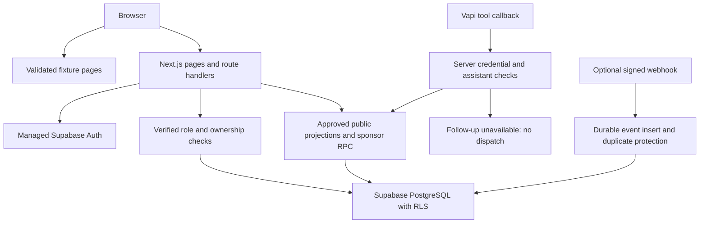

# Architecture

`/listings` keeps the validated Gemini fixture JSON and existing filters.
`/listings/live` validates the public `/api/listings` response and provides
loading, empty, error and retry states. The route selects approved properties
with explicit public columns. `/services` reads approved hosted services and submits
validated bookings. Public booking reads are denied.

Sign-in uses managed Auth and server-managed cookies. Protected dashboard reads
verify the user and role. Existing provider/admin APIs keep their bearer-token
authorization. Privileged clients remain server-only and follow authorization.

Sponsor reads use the narrow eligibility RPC; browser draft writes are limited
to the protected merchant owner. Analytics uses strict minimized fields and
provider ownership/admin RLS. The public dashboard uses fixtures in page memory.

The Vapi callback validates a dedicated server credential, assistant identity and
strict tool arguments. It reads approved facts; follow-up has no transport and
returns unavailable. Public synthetic HTTP tests are not provider-issued calls.
The optional Twilio route is `/api/webhooks/voice`; the legacy Twilio route returns HTTP 410.
Outbound SMS is off by default. No SMS-status endpoint or separate worker is
claimed.

See the [data dictionary](data-dictionary.md), [current hosted setup](mfalujo23/hosted-reproduction.md),
[voice runbook](voice-runbook.md) and [operations](operations-runbook.md).
