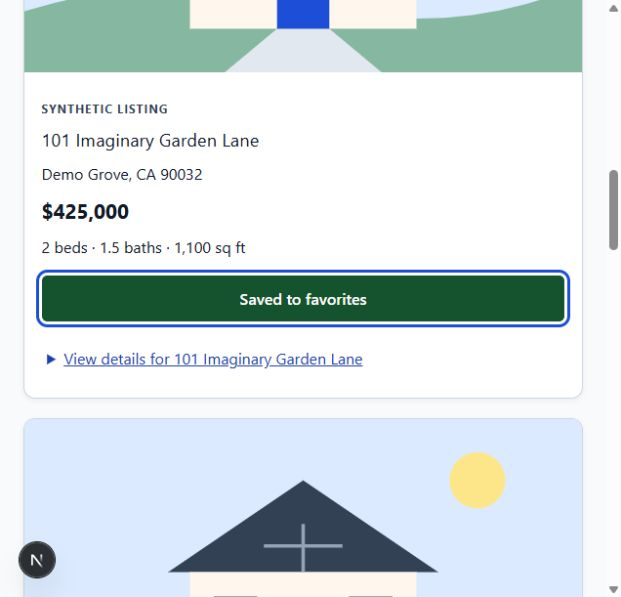
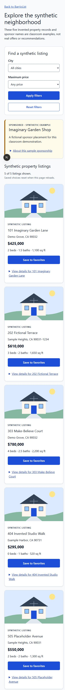
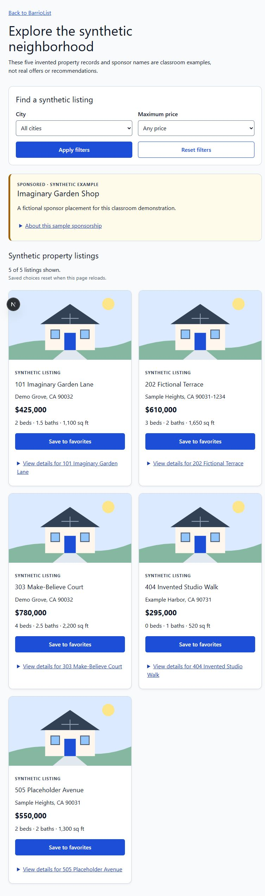
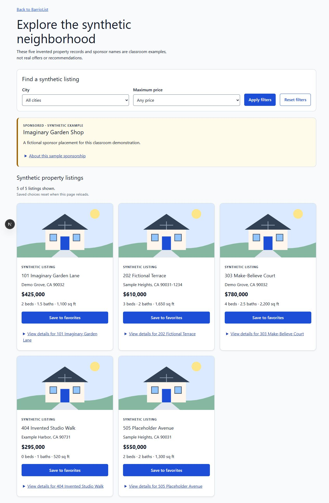

# Property-card audit: current remediation evidence

Canvas source: https://calstatela.instructure.com/courses/133397/assignments/2597718

Prepared November 18, 2026, with Codex assistance for the authorized mfalujo23 remediation. This document describes the current local changes, not the different examples in the preserved teammate document `docs/audit.md`.

## Exact current JSX: semantic wrapper and title

From `src/components/PropertyCard.tsx` (15 lines):

```tsx
    <article aria-labelledby={headingId} className={styles.card}>
      <Image
        src="/synthetic-home.svg"
        alt={`Schematic house illustration for the synthetic listing at ${property.street}, ${property.city}`}
        width={640}
        height={360}
        className={styles.image}
      />
      <div className={styles.cardBody}>
        <p className={styles.eyebrow}>Synthetic listing</p>
        <h3 id={headingId}>{property.street}</h3>
        <p>{property.city}, {property.state} {property.zip_code}</p>
        <p className={styles.price}>
          {new Intl.NumberFormat('en-US', { style: 'currency', currency: 'USD', maximumFractionDigits: 0 }).format(property.price)}
        </p>
```

The page `/listings` supplies the `h1`. Its listing-results section has `h2` and the individual article titles are `h3`. The article's `aria-labelledby` refers to the unique title derived from `property_id`. The `Image` component's dynamic alt describes a schematic illustration and includes the synthetic street/city; it does not misrepresent the drawing as an actual property photograph.

## Interactive controls and actual handler

The view's controls are: a skip link, a Back to BarrioList link, labeled City and Maximum price selects, Apply filters, Reset filters, a sponsor disclosure summary, and for each displayed card a favorite button and a details summary. There are no interactive card wrappers or duplicate click handlers.

Exact favorite-control JSX from `PropertyCard.tsx`:

```tsx
        <button
          type="button"
          aria-pressed={saved}
          aria-label={`${saved ? 'Remove' : 'Save'} the synthetic listing at ${property.street}${saved ? ' from' : ' to'} favorites`}
          onClick={() => setSaved((previous) => !previous)}
          className={styles.button}
        >
          {saved ? 'Saved to favorites' : 'Save to favorites'}
        </button>
```

This handler toggles actual React state; its accessible name includes the listing address and its pressed state is exposed. Native `details`/`summary` elements expose their own expanded state and keyboard behavior. The filter form submits into `onApply` after preventing navigation; Reset clears local selections and the active filter state. `useId` ties each visible label to its own select without hard-coded duplicate IDs.

## Exact current focus and responsive CSS

From `src/components/listings.module.css`:

```css
.button:focus-visible, .secondaryButton:focus-visible, .field:focus-visible,
.details summary:focus-visible, .intro a:focus-visible, .skipLink:focus-visible {
  outline: 3px solid #1d4ed8;
  outline-offset: 3px;
}
```

```css
.grid { display: grid; grid-template-columns: minmax(0, 1fr); gap: 1.25rem; margin-top: 1.5rem; }

@media (min-width: 640px) {
  .grid { grid-template-columns: repeat(2, minmax(0, 1fr)); }
  .filterForm { grid-template-columns: repeat(2, minmax(0, 1fr)); }
}

@media (min-width: 1024px) {
  .grid { grid-template-columns: repeat(3, minmax(0, 1fr)); }
  .filterForm { grid-template-columns: 1fr 1fr auto auto; }
}
```

## Actual localhost keyboard trace

The root browser-control agent performed these checks at `http://localhost:3000/listings` on November 18, 2026, and supplied the actual observations below. This remediation agent consolidated that evidence; it does not attribute the browser work to the student.

Observed Tab order through the first card: Skip to listing results; Back to BarrioList; City select; Maximum price select; Apply filters; Reset filters; sponsorship summary; first-card Save button. The observer checked a computed 3px blue outline on these focused controls. Space on the first Save control set `aria-pressed="true"` and visible text to `Saved to favorites`. The following Tab then Enter expanded the first card's native details, exposing amenities and fictional sponsor names.



The focus screenshot was captured at a 636px viewport; it is not the 375px layout screenshot.

## Actual responsive and filter observations

| Viewport width | Observed grid columns | Observed column widths | Horizontal overflow |
|---:|---:|---|---|
| 375px | 1 | 312px | None |
| 768px | 2 | 342.5px, 342.5px | None |
| 1280px | 3 | 370.656px, 370.672px, 370.656px | None |





The observer applied City `Demo Grove` and Maximum price `$600,000`: the status became `1 of 5 listings shown`. Reducing the maximum to `$400,000` produced `0 of 5 listings shown` and the helpful empty-state message. Reset restored `5 of 5 listings shown`. These are performed browser observations, not predictions based on source.

No automated accessibility conformance or WCAG compliance claim is made by this document.
