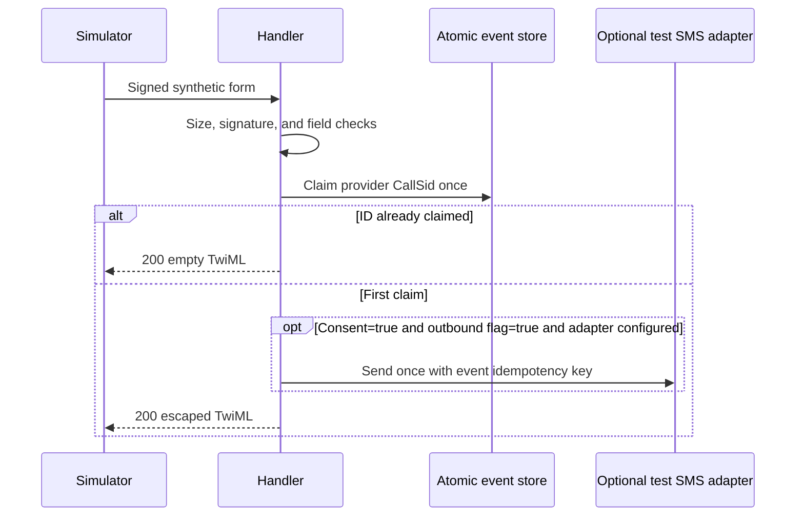

# Lab 9: Telephony webhook remediation

Prepared for `mfalujo23` with Codex assistance on November 18, 2026. This is new remediation work; it does not change the authorship or pre-merge review history of Gabriela's PR #33.

## Implemented behavior

`POST /api/webhooks/voice` accepts only `application/x-www-form-urlencoded` (an optional charset is supported). It reads at most 16 KiB, verifies all received fields against the server-configured `PUBLIC_CALLBACK_URL` and `TWILIO_AUTH_TOKEN`, and rejects ambiguous repeated field names. The required fields are `CallSid` (a provider CA identifier), `From` (E.164 form), and `CallStatus` (a recognized provider status). The handler returns 400 for invalid fields, 403 for a missing/invalid signature, 413 for an oversized body, 415 for an unsupported content type, and 405 for non-POST methods.

Successful responses are `text/xml; charset=utf-8` TwiML. Configured project names are XML-escaped. Duplicate provider IDs return empty TwiML and never call the SMS adapter again.



## SMS safety and delivery limits

- `ENABLE_OUTBOUND_SMS` is disabled unless its exact value is `true`.
- Consent is explicit only when the signed `Consent` field is exactly `true`.
- The confirmation identifies the project and includes `Reply STOP to opt out.`
- The helper requires an injected `send` adapter and only reports `sent: true` after that adapter resolves. The Next.js route intentionally has no live SMS adapter wired, so enabling SMS with consent returns 503 before persisting the event. No actual SMS or call was sent during remediation.
- The provider ID is claimed before attempting delivery. If an adapter fails after an ambiguous send, its claim is retained to prevent a duplicate send on retry. This is **at-most-once attempt** behavior, not guaranteed delivery or an exactly-once transaction with the provider. Production reliability would require an outbox/provider reconciliation workflow before sending real messages.

## Idempotency modes

| Configuration | Behavior | Verification status |
| --- | --- | --- |
| `WEBHOOK_STORE_DRIVER=local-file`, nonproduction only | One exclusively created file per hashed provider ID under `data/webhook-events/`; no full phone number stored | Tested locally, including parallel duplicate requests and separate adapter instances |
| `WEBHOOK_STORE_DRIVER=supabase` | Atomic POST to `telephony_webhook_events` with a primary key on the provider ID; PostgreSQL uniqueness error 23505 means duplicate | Fake-transport unit tests only; migration and real database behavior not verified |
| Hosted runtime with no durable driver, or `local-file` on hosted runtime | 503; no successful processing or SMS claimed | Tested with production configuration |

Local files are not shared durable storage for Vercel. The hosted adapter requires review/application of `supabase/migrations/20261118000100_telephony_webhook_events.sql`, the existing server-only `SUPABASE_URL` and `SUPABASE_SERVICE_ROLE_KEY`, and verification in the project owner's environment. The migration enables RLS, denies anonymous/authenticated access, and permits service-role inserts. It was **not applied** during this work. The adapter does not log upstream response bodies or credentials.

The event record contains only the provider ID, call status, redacted phone suffix, and processing timestamp. Logs contain only `eventId`, a controlled `status`, and `phoneSuffix`. No full numbers, caller audio, transcripts, recordings, raw form bodies, or credentials are logged or persisted.

## Reproduce the local simulator

Use fictional data only. `fixtures/inbound-call.json` uses synthetic identifiers and reserved NANP 555-01xx example numbers. Never place a real token or caller payload in this file.

Set these values in the environment of both the development server and simulator:

```text
TWILIO_AUTH_TOKEN=synthetic-lab9-token
PUBLIC_CALLBACK_URL=http://127.0.0.1:3000/api/webhooks/voice
WEBHOOK_STORE_DRIVER=local-file
ENABLE_OUTBOUND_SMS=false
PROJECT_NAME=Neighborhood Listing Platform
```

Start the normal development server, then run:

```text
node scripts/simulate-webhook.js
```

The simulator permits loopback targets only, forces fictional consent=false, and submits the same new random provider ID twice. Expected results are HTTP 200 with a greeting, then HTTP 200 with empty TwiML. It refuses to run with outbound SMS enabled. It is not a tool for testing a real hosted provider endpoint.

## Actual test evidence

On November 18, 2026, Codex ran:

```text
node --test tests/webhook.test.js
```

Result: **19 passed, 0 failed** using Node 24.22.3. The full console output is captured in the workspace's `work/lab9-evidence/webhook-tests.txt`; the publishable test transcript is `evidence/lab9-webhook-tests.txt` with the local-path module warning omitted. The suite covers valid/invalid/missing/tampered signatures, callback URL spoofing, required-field validation, repeated fields, methods/content types/body size, concurrent duplicates, local restart deduplication, both consent gates, missing adapters, ambiguous SMS failure, XML escaping, minimal logs/store records, hosted fail-closed behavior, unavailable storage, and fake Supabase insert/conflict responses.

These results are automated local evidence. They do not establish that Michael personally ran the checks, that a peer reviewed the work, that a real database migration succeeded, or that a deployment/provider integration was tested. The terminal reports a nonfatal module-type warning because the shared package does not declare an ES module type; this file does not alter the team's package configuration.

## Verified Next.js HTTP run

On November 18, 2026 at approximately 22:41 UTC (2:41 PM Los Angeles), Codex also ran the real Next.js development route on `http://127.0.0.1:3000/api/webhooks/voice` with the explicit synthetic environment above. The repository simulator submitted an identical fictional event twice and received 200 with greeting TwiML followed by 200 with empty duplicate TwiML.

A separate local HTTP matrix captured actual response headers and bodies:

| Case | Actual HTTP result |
| --- | --- |
| Valid signed first event | 200, XML greeting |
| Identical provider retry | 200, empty XML response |
| Invalid signature | 403 |
| Correctly signed form missing CallStatus | 400 |
| GET | 405 with `Allow: POST` |
| Unsupported content type | 415 |

Sanitized transcripts preserving the actual response header values and bodies are saved alongside this runbook in `evidence/lab9-local-http.txt` and `evidence/lab9-simulator.txt`. The workspace retains the unabridged local terminal captures in `work/lab9-evidence/next-http-responses.txt`, `next-http-results.json`, and `simulator-output.txt`. The publishable transcripts omit the Node warning containing local filesystem paths, and the HTTP transcript begins at the first response case; no response values were changed. No real provider, real phone number, outbound SMS, or hosted database was involved.

## Remaining credit/evidence steps

Publish this work through a branch and PR attributable to the selected `mfalujo23` account, identify Codex assistance, obtain the instructor-required peer review or record the instructor's solo exception, and include real issue/PR/commit URLs in the Canvas submission. Do not describe this retrospective remediation as a review performed before PR #33 was merged. Individual credit and acceptance of late work remain the instructor's decision.

## Reference checks

- [Twilio request signatures](https://www.twilio.com/docs/usage/security)
- [Twilio call status values](https://www.twilio.com/docs/voice/api/call-resource)
- [Vercel function filesystem limits](https://vercel.com/docs/functions/runtimes#file-system-support)
- [PostgREST uniqueness errors](https://docs.postgrest.org/en/stable/references/errors.html)
